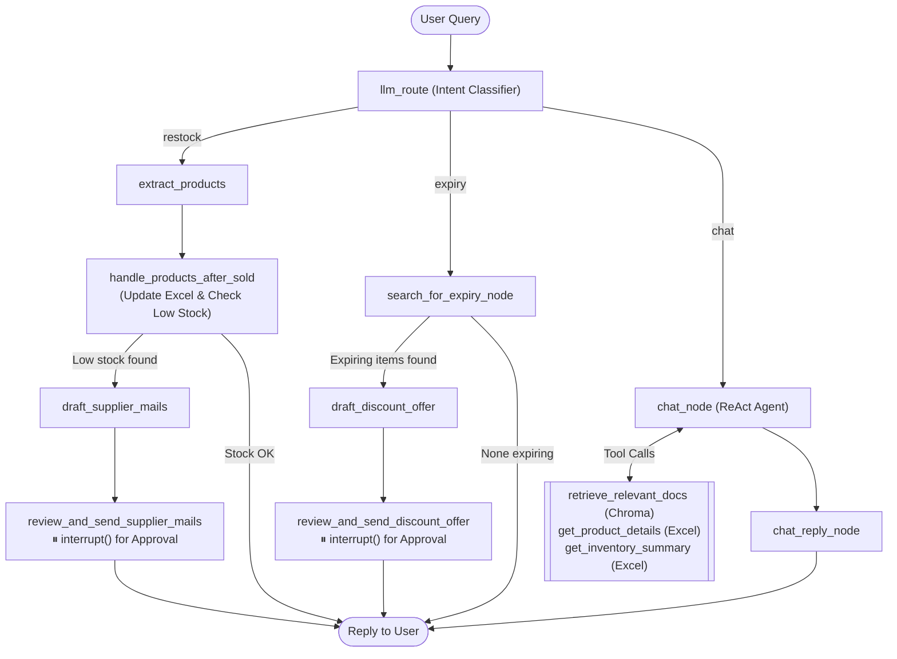

# Inventory Management Agent

An interactive, multi-path **LangGraph** agent for supermarket inventory management. It classifies natural-language user requests and routes them across three specialized workflows: **automated stock deduction & supplier restocking**, **near-expiry discount campaigns**, and a **hybrid RAG + live-Excel conversational assistant**—complete with human-in-the-loop approval via LangGraph interrupts.

---

## Key Features

- **Intent-Based Routing:** Automatically classifies user input into `restock`, `expiry`, or `chat` flows using structured LLM output (`gemini-flash-lite-latest`).
- **Automated Sales & Restock Workflow (Path A):** Extracts sold product names and quantities from natural language, deducts stock from the live Excel sheet, detects low-stock items, and drafts grouped supplier restock emails.
- **Expiry Check & Discount Workflow (Path B):** Scans inventory for products expiring within a configurable window and drafts 40%-off customer discount notifications.
- **Hybrid RAG + Live Data Chat Agent (Path C):** Combines semantic product search in **ChromaDB** (`Qwen/Qwen3-Embedding-0.6B`) with live Excel lookup tools using `InjectedState` for accurate real-time stock and pricing queries.
- **Human-in-the-Loop Approval:** Pauses graph execution with `interrupt()` before sending supplier or discount notifications, resuming via `Command(resume=...)` only after manager confirmation.
- **Session Memory:** Maintains multi-turn conversation state across the CLI session with `MemorySaver`.

---

## Architecture & Workflow



---

## Project Layout

```text
project/
├── agent.py                       # Interactive LangGraph CLI agent
├── build_vector_db.py             # Script to build ChromaDB from the Excel inventory
├── requirements.txt               # Python package dependencies
└── data/
    ├── inventory_data.xlsx        # Live source of truth for inventory data
    └── vector_db/
        └── chroma_data/           # Persisted Chroma collection ("Inventory")
```

### Expected Excel Columns (`data/inventory_data.xlsx`)

| Column | Used By |
|---|---|
| `Product Name` | All workflows and tools |
| `Product Description` | Vector DB embeddings, `get_product_details` tool |
| `Product Quantity` | Stock deduction, low-stock checks, live tools |
| `Product Price` | Expiry discount calculation, live tools |
| `Product Expiry Date` | Expiry check, vector DB, live tools (parsed as date) |
| `Product Supplier Email` | Grouped supplier restock email drafts |

---

## Quick Start

### 1. Install Dependencies

```bash
pip install -r requirements.txt
```

**External models & services used:**
- **Google Gemini** (`gemini-flash-lite-latest`) for intent routing, entity extraction, and chat. Requires a `GOOGLE_API_KEY`.
- **Hugging Face Embeddings** (`Qwen/Qwen3-Embedding-0.6B`), downloaded automatically on first run and executed locally on CPU.

### 2. Configure Environment Variables

Create a `.env` file in the project root:

```env
GOOGLE_API_KEY="your-google-api-key"
```

*(Alternatively, export `GOOGLE_API_KEY` directly in your shell environment.)*

### 3. Build the Vector Database (First-Time Setup)

If `data/vector_db/chroma_data/` is not yet populated or you want to rebuild it from `data/inventory_data.xlsx`:

1. Open `build_vector_db.py` and uncomment `build_vector_db_from_texts(parsed_texts, embeddings)` in the `__main__` block.
2.*(Optional)* Delete `data/vector_db/chroma_data` first if rebuilding from scratch to avoid duplicate documents.
3. Run:

```bash
python build_vector_db.py
```

### 4. Run the Agent

```bash
python agent.py
```

### Example Prompts

| Prompt | Routed Path |
|---|---|
| `sold 2 Organic Whole Milk 1L and 3 Large Free-Range Eggs 12pk` | **Path A** (Restock / inventory deduction) |
| `check for near expiring products` | **Path B** (Expiry check & 40% discount drafts) |
| `what products cost less than 1?` | **Path C** (Chat -> `get_inventory_summary`) |
| `how much Organic Whole Milk 1L do we have left?` | **Path C** (Chat -> `get_product_details`) |
| `do we have lactose free products?` | **Path C** (Chat -> `retrieve_relevant_docs` semantic search) |

---

## Detailed Component Reference

### 1. `build_vector_db.py`

Builds the Chroma vector store used by the chat agent for semantic product discovery.

- **`retreive_parse_data_from_excel(file_path: str) -> list[str]`**
  Reads `data/inventory_data.xlsx` (`Product Expiry Date` parsed as date) and formats each row into a text block containing `Product Name`, `Product Description`, `Product Quantity`, and `Product Expiry Date`.
- **`build_vector_db_from_texts(texts: list[str], model) -> None`**
  Embeds the text blocks with `Qwen/Qwen3-Embedding-0.6B` and persists them to `./data/vector_db/chroma_data` under the `Inventory` collection.

> **Note:** The vector database is a static snapshot used for semantic/descriptive queries. Live stock counts and prices are always read directly from `data/inventory_data.xlsx`.

---

### 2. `agent.py`

#### Configuration Defaults

| Parameter | Default Value | Description |
|---|---|---|
| `model` | `gemini-flash-lite-latest` | ChatGoogleGenerativeAI model |
| `embeddings` | `Qwen/Qwen3-Embedding-0.6B` (CPU) | Local Hugging Face embedding model |
| `DB_PATH` | `./data/inventory_data.xlsx` | Live Excel inventory file path |
| `QUANTITY_THRESHOLD` | `5` | Stock level below which restock emails are drafted |
| `EXPIRY_CHECK_DAYS_THRESHOLD` | `20` | Lookahead window (in days) for near-expiry products |
| `SYSTEM_EMAIL_ID` | `inventory_agent@example.com` | Sender email used in generated drafts |

#### Graph State (`InventoryAgentState`)

Extends LangGraph's `AgentState` (`messages` history) with custom workflow fields:

| Field | Description |
|---|---|
| `user_query` | Raw user input for the current turn |
| `message` | Formatted response rendered in the CLI output panel |
| `messages` | Conversation history shared across turns |
| `current_date` | Reference date (`date.today()`) for expiry calculations |
| `DB_PATH` | Path to the Excel inventory file (injected into tools via `InjectedState`) |
| `EXPIRY_CHECK_DAYS_THRESHOLD` | Days ahead to scan for expiring items |
| `QUANTITY_THRESHOLD` | Low-stock threshold |
| `SYSTEM_EMAIL_ID` | Sender address for email drafts |
| `user_query_classification` | Router classification (`restock`, `expiry`, or `chat`) |
| `products_from_user_query` | Extracted `[{"product_name": str, "quantity": int}]` from sales queries |
| `empty_products` | Low-stock products (`Product Name`, `Product Quantity`, `Product Supplier Email`) |
| `supplier_drafts` | Grouped restock email drafts per supplier |
| `expiry_products` | Products expiring within the threshold window |
| `discount_offer_drafts` | Customer discount email drafts (40% off) |

#### Chat Agent Tools (Path C)

| Tool | Purpose |
|---|---|
| `get_product_details(product_name)` | Case-insensitive substring search on `Product Name` in Excel; returns live quantity, price, description, and expiry date. |
| `get_inventory_summary(report_type, operator, threshold)` | Filters live Excel inventory by `stock` or `price` (`<`, `<=`, `>`, `>=`, `=`), or returns an `overview` of total SKUs and units. |
| `retrieve_relevant_docs(query)` | Semantic similarity search (`k=5`) against ChromaDB for descriptive product questions. |

#### Human-in-the-Loop Approval Flow

Both `review_and_send_supplier_mails` (Path A) and `review_and_send_discount_offer` (Path B) call `interrupt({"question": ..., "drafts": ...})`.
1. The CLI displays all drafted notifications and prompts the user (`Send these notifications?`).
2. Accepted inputs: `yes`, `y`, `approve`, `approved`, `ok`, `accept`, `accepted`.
3. Refusal inputs: `no`, `n`, `refuse`.
4. The graph resumes via `workflow.invoke(Command(resume=decision), config=config)`. Approved notifications print `[SENT]` confirmation lines to the terminal.

---

## Known Limitations

- **Exact Product Name Matching in Path A:** `update_inventory_data` matches `Product Name` exactly (`==`), so partial or misspelled names extracted from a receipt will not deduct stock.
- **Static Vector DB Snapshot:** ChromaDB is not automatically re-indexed after stock updates in Path A.
- **Simulated Email Delivery:** Approved supplier and discount emails are printed to the console (`--> [SENT]`) rather than sent via SMTP/API.
- **Growing Message Context:** Full email draft bodies are appended to `messages`, increasing token usage over long sessions.
- **In-Memory Session Only:** `MemorySaver` stores state in RAM under a single `session-1` thread ID; history resets when the process exits.
- **Online Mermaid Rendering:** `workflow.get_graph().draw_mermaid_png()` calls an external Mermaid service on startup and requires internet access.
